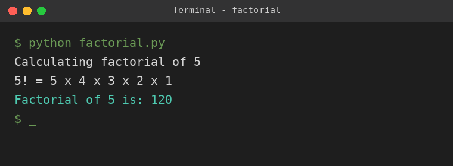

# Factorial of 5

A simple Python project that calculates the factorial of a number (default: **5**).

## What is a factorial?
The factorial of a non-negative integer `n` (written `n!`) is the product of all positive integers up to `n`.

```
5! = 5 x 4 x 3 x 2 x 1 = 120
```

## Project Structure
```
factorial_project/
├── factorial.py            # Python source code
├── README.md               # Project documentation
└── output_screenshot.png   # Screenshot of program output
```

## Requirements
- Python 3.6+

## How to Run
```bash
python factorial.py
```

## Output
```
Calculating factorial of 5
5! = 5 x 4 x 3 x 2 x 1
Factorial of 5 is: 120
```



## How It Works
The `factorial(n)` function starts with `result = 1` and multiplies it by every number from 2 to `n`. It raises a `ValueError` for negative input.

To calculate another number, change `number = 5` in `factorial.py`.
